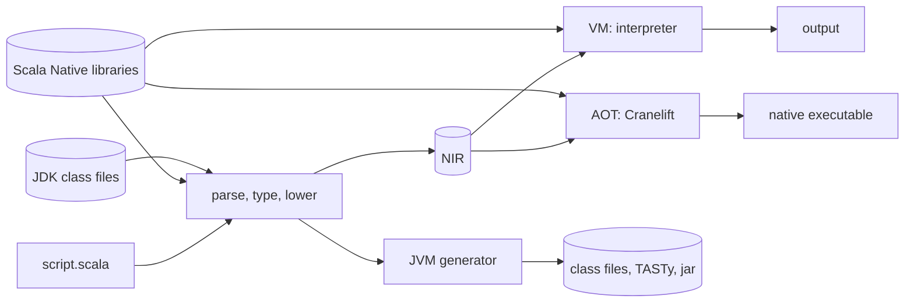

# Scivolo

A Scala 3.9 interpreter and compiler for scripts, written in Rust, with no JVM.

- Runs `.scala` and `.sc` scripts, a REPL, and builds native executables.
- Executes Scala Native's NIR with Scala Native's precompiled libraries and C runtime.
- Has its own frontend: dotty's parser, typer and lowering phases, ported to Rust.
- Has a second backend, `scivolo-jvm`: class files, TASTy and jars for the JVM, from the same
  frontend.

## Status of the project

- **Research and benchmarking project**, not a product. No releases, no stability guarantees;
  not for production use. Build it from source.
- **Written by AI agents** (Claude Code): an experiment in how far that approach carries a
  project of this size.
  - Humans chose the goals and the order of work, reviewed code style and tested behaviour.
  - Most code has not been reviewed line by line; it has not been audited for security.
  - Correctness rests on automated checks against upstream: the NIR the frontend writes is
    compared byte for byte with Scala Native's, and the VM runs Scala Native's and dotty's test
    suites (see Progress).
- **The prior art belongs to the Scala and Scala Native teams.** Most of the code is a
  mechanical translation of the Scala 3 compiler (dotty) and of Scala Native's compiler plugin
  and runtime. Their designs and algorithms are kept; Scivolo changes the language and the
  execution model.
- **Translated code is marked:** each such file starts with a license notice naming its upstream
  files; [NOTICE](NOTICE) carries the upstream attributions, [acknowledges.md](acknowledges.md)
  the projects, designs and ideas used.

## Why

- We want scripts that start fast, use little memory and are type-checked.
- We love Scala and want it as a scripting language.
- We want to find out how far an AI-driven port of a compiler and runtime carries.

## Goals

Simplified from [ROADMAP.md](ROADMAP.md), which holds the targets and their status.

1. **Fast start:** edit-then-run of a small script ≤ 50 ms, about 3x python3's startup;
   CPU-bound code within 3x of CPython.
2. **Byte-exact translation and interpretation:** the own frontend writes the same NIR as
   Scala Native's compiler, byte for byte; the VM prints what Scala Native binaries print.
3. **Fast compilation:** no JVM, no compile server.
4. **Macros without a JVM:** library macros run from their NIR in the VM.

## Progress

Headline numbers (macOS arm64, M4 Pro); every suite, date and gap is in
[docs/conformance.md](docs/conformance.md) and [ROADMAP.md](ROADMAP.md).

- **VM:** 11,336 of Scala Native's 11,360 unit tests pass (NIR compiled by Scala Native).
- **Own frontend:** 1,497 of dotty's 1,711 `tests/run` pass through parser, typer, lowering
  and VM.
- **Macros:** 308 of dotty's 321 `tests/run-macros` pass.
- **Scala Native's library through the own frontend:** javalib 601 of 601 files, auxlib 15 of
  15, nativelib 103 of 103, clib, posixlib and windowslib complete; scalalib 649 of 649.
- **com-lihaoyi libraries from source:** fastparse, mainargs, upickle, ujson, pprint, os-lib,
  geny, fansi and sourcecode compile through the own frontend, every file, macros included;
  1,777 of their 1,786 NIR files are the same as scala-cli's.
- **Native executables:** 308 of 318 test programs, built from source.
- **JVM backend:** 1,603 of dotty's 1,711 `tests/run` and 307 of 321 `tests/run-macros` pass on
  `java -Xverify:all`.
- **Startup:** hello 7.5 ms from the heap snapshot; `moderate.scala` 48 ms edit-then-run
  (scala-cli: 360–520 ms, python3 startup: 18 ms).

Features:

- [x] NIR interpreter with Scala Native's libraries, garbage collector and stack traces
- [x] Java threads as green threads
- [x] Own frontend for the scripting subset; scala-cli as the fallback for the rest
- [x] Scripts with `//> using` directives, dependencies from Maven via Coursier
- [x] REPL with completion, history and dependencies
- [x] Native executables via Cranelift (single-threaded)
- [x] Macros: a subset of `scala.quoted` (Circe's `derives Codec.AsObject` works)
- [x] The com-lihaoyi toolkit (fastparse, mainargs, upickle, pprint, os-lib) in scripts and
      compiled from source
- [x] Startup from a heap snapshot
- [x] JVM backend: class files, TASTy and jars; JDK classes read from the JDK's class files
- [ ] Typer: the rest of Scala 3 (match types in part; GADTs, capture checking)
- [ ] Macros: the rest of `Quotes`
- [ ] OS threads
- [ ] JIT compiler

## Platforms

- macOS arm64 (development)
- Linux x86-64
- Both tested in GitLab CI and GitHub Actions. Windows is not supported.

## Usage

Needs Rust 1.97+, `just`, a C compiler; optional: Coursier (`--dep`), scala-cli (fallback
frontend), a JDK 17+ (`scivolo-jvm`).

```sh
just fetch-libs                 # once: Scala Native's library jars into ref/libs
cargo build --release -p scivolo -p scivolo-aot
```

Outside `just`, set `SCIVOLO_LIBS` to `ref/libs`, or let `scivolo` find the jars in the
Coursier cache.

### Scripts

```sh
scivolo hello.scala ARGS        # compile through the own frontend (cached), then run
scivolo --main Main app.scala   # choose the main class
scivolo -O -Werror app.scala    # pass a Scala compiler option
scivolo --dep io.circe::circe-parser::0.14.10 app.scala
```

- Also runs as a `#!/usr/bin/env scivolo` shebang.
- The compiled NIR is cached; later runs compile nothing.
- Code the own frontend refuses compiles through scala-cli, with a note on stderr.
- Options, frontends, cache and diagnostics: [docs/scripts.md](docs/scripts.md).

### REPL

```sh
scivolo                         # or: just repl
scivolo --dep io.circe::circe-generic::0.14.10
```

```
Welcome to Scivolo 0.2.1 (target Scala 3.9.0). Type in expressions for evaluation. Or try :help.
> case class P(x: Int)
// defined case class P
> P(1)
val res0: P = P(1)
```

### Native executables

```sh
scivolo-aot -o hello hello.scala       # from sources, through the own frontend
scivolo-aot --cp DIR -o app Main       # from NIR files in DIR, main class Main
./hello
```

### JVM class files

```sh
cargo build --release -p scivolo-jvm
scivolo-jvm -d out hello.scala                          # class and TASTy files into out/
scivolo-jvm -d app.jar --main-class Main app.scala      # a jar with its manifest
scivolo-jvm --cp lib.jar -d out app.scala               # against a jar's TASTy
java -cp out:ref/libs/scala-library-3.9.0.jar Hello
```

- Runs on Java 17+; reads the JDK classes it needs from the installed JDK.
- Conformance and checks on the JVM: [docs/conformance.md](docs/conformance.md).

## How it works



1. **Parse:** a port of dotty's parser turns the source into syntax trees.
2. **Type:** a port of dotty's typer checks the program against the libraries' TASTy; inline
   methods and macros expand here, macros run in the VM.
3. **Lower:** dotty's later phases simplify the typed trees, then Scala Native's code generator
   turns them into NIR.
4. **Interpret:** the VM runs the NIR with Scala Native's libraries, C runtime and garbage
   collector.
5. **Compile:** `scivolo-aot` compiles the NIR with Cranelift into a native executable.
6. **JVM:** `scivolo-jvm` turns the same lowered trees into class files, TASTy and jars.

Decisions are in [docs/adr/](docs/adr/), research in [docs/research/](docs/research/).

## Crates

The package in `crates/<dir>` is `scivolo-<dir>` (`crates/scivolo` is `scivolo`).

| Dir | Purpose |
|---|---|
| `scivolo` | The CLI: runs scripts, starts the REPL. |
| `aot` | `scivolo-aot`: builds native executables. |
| `syntax` | Parser. |
| `typer` | Typer. |
| `tasty` | Reads the libraries' TASTy. |
| `lower` | Lowering to NIR. |
| `macros` | Runs macros in the VM. |
| `repl` | The REPL. |
| `vm` | The NIR interpreter. |
| `nir` | Reads and writes NIR. |
| `jvm` | `scivolo-jvm`: the JVM backend. |
| `classfile` | Reads and writes class files. |
| `libs` | Finds the library jars and fetches dependencies. |
| `libimage` | The cached image of the libraries. |
| `snrt` | Builds Scala Native's C runtime. |
| `nir-dump` | Prints NIR files; a development tool. |

Outside the crates:

- `overlay/src`: Scala sources that fix or add library members.
- `native/`: Scala Native's C runtime sources.
- `tests/`: test programs, REPL transcripts, AOT programs; `spikes/`: throwaway experiments.

## Checked-in upstream artifacts

| Path | What | Rebuilt by |
|---|---|---|
| `native/` | Scala Native 0.5.12's C runtime (nativelib, javalib, posixlib, clib), copied; patched files marked | by hand, checked by `just native-stale` |
| `libs/javalib-tasty-0.5.12.jar` | TASTy of Scala Native's javalib, which the published jar lacks | `just javalib-tasty` |
| `libs/jdk-stubs.jar`, `libs/jdk-declarations.jar` | TASTy of the JDK declarations the libraries use | `just jdk-stubs` |
| `libs/jdk-stubs/JdkConstants.scala`, `JdkClassConstants.scala` | The JDK's constants | `python3 scripts/jdk_constants.py` |
| `tests/programs/*/` | NIR and expected output of each test program, compiled by Scala Native | `just program-update NAME` |
| `overlay/nir` | NIR of `overlay/src`, compiled by Scala Native | `just overlay` |
| `tests/macros/lib/macros.jar`, `crates/*/tests/**` jars, `.nir`, `.tasty` | Test fixtures compiled by dotty or Scala Native | `just macro-fixture`, `just inline-fixture` |

The library jars themselves are not checked in: `just fetch-libs` downloads them from Maven
Central and checks their SHA-256.

## Development

```sh
just gates                      # fmt, clippy, tests: must pass before every commit
just check                      # every test program against its .check file, with timings
just --list                     # all recipes: oracles, reports, benchmarks
```

Rules for contributors (human or agent): [CLAUDE.md](CLAUDE.md). Work is tracked in GitLab
issues.

- Issues and pull requests on the GitHub mirror are welcome; pull requests run GitHub Actions.
- Internal work is ahead of the GitHub mirror: before a large pull request, please open an issue.

## License

Apache-2.0, see [LICENSE](LICENSE) and [NOTICE](NOTICE). Translated code keeps its upstream
license notices; JLine (BSD-3-Clause) and PPrint (MIT) in [licenses/](licenses/).
